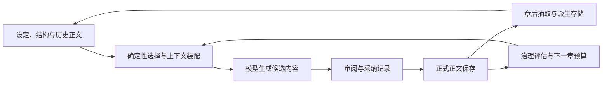

# PlotPilot 的工程模型：状态、提交与反馈

本文解释系统为什么这样组织，以及这些组织方式能保证什么。目录与入口见 [ARCHITECTURE.md](ARCHITECTURE.md)，能力清单、依赖基线与迁移前提见 [ARCHITECTURE_TRANSFERABILITY.md](ARCHITECTURE_TRANSFERABILITY.md)，模型协议与连接生命周期见 [LLM_RUNTIME.md](LLM_RUNTIME.md)。

源码核对基线为 `fd1bbb8f`（2026-11-25）。下文区分三类结论：**已实现机制**有调用链支持；**受控反例**只证明给定输入下的行为；**演进要求**是后续改动应满足的条件，并不表示代码已经实现。本文不是完整线上事故复盘，也不以单元测试替代真实模型长篇连写验证。

## 1. 核心问题：如何让非确定性产物参与长期状态演进

理解这个项目的起点不是“用了多少种 Agent”，而是：一次生成会改变下一次生成所看到的世界。正文不只是输出文件，它还会转化为摘要、人物状态、因果边、伏笔与债务，重新进入后续提示词。因此，一章的抽取错误可能在后文被当作事实反复使用。

实际闭环跨过四种操作：



这张图是职责关系，不是每条路径都遵循的单一事务。实际边界见下文。主要工程取舍可以归纳为：

| 取舍 | 代码中的落点 | 获得的能力与代价 |
| --- | --- | --- |
| 用确定性规则约束生成，再用模型产出内容 | `NarrativeGovernanceService`、`ContextBudgetAllocator`、Invocation spec | 规则可解释、可测；提示词中的规则仍需另行验证是否被遵守 |
| 候选、采纳、正式保存分开 | `InvocationAttempt`、`AdoptionDecision`、`AdoptionCommit`、StoryPipeline save step | 可审阅、可追踪、可复用候选；“调用完成”不能直接代表章节完成 |
| 以章节作为主要稳定产物 | 临时 generation workspace 与正式 `chapters` 分离 | 中断时避免把半章当完稿；可能重新承担模型调用成本 |
| 正文保存与部分派生处理分开 | `ChapterAftermathPipeline`、审计委托、辅助任务队列 | 降低非关键失败对写作的阻塞；产生知识缺失、滞后和重建问题 |
| 写入串行，生成与协调并行 | SQLite writer dispatch、独立 daemon、采纳协调线程 | 写入所有权更清楚；长时间占用 writer 会阻塞其他业务 |
| 展示状态允许压缩与推断 | DAG projection、事件聚合器、前端有界队列 | 界面负担较小；可视状态不能代替业务回执 |

证据入口：[章节管线](../engine/pipeline/base.py)、[治理服务](../application/governance/service.py)、[调用编排](../application/ai_invocation/gateway.py)、[章后管线](../application/engine/services/chapter_aftermath_pipeline.py)。

## 2. 先问哪个问题，再选择权威数据

项目没有一张能回答所有问题的“总状态表”。不同问题需要不同证据；物理上落盘，也不自动赋予数据业务权威。

| 要回答的问题 | 应读取的状态 | 不能据此推出的结论 |
| --- | --- | --- |
| 正式正文是什么、哪些章节已完成？ | `chapters` 的内容与状态；下一章定位还要结合结构树 | 已完成章节的所有派生知识都已更新 |
| 计划写到哪里、还有哪些章未落地？ | story nodes、章节事实、恢复策略 | `current_stage` 字符串单独证明所有前置动作已完成 |
| 模型当时看到了什么？ | prompt snapshot、变量快照、attempt | 当前世界仍与快照一致，或再次调用会得到相同输出 |
| 谁采纳了哪个候选，副作用执行到哪里？ | decision、commit、step receipt | 整个采纳过程处在同一个数据库事务里 |
| 人物当前状态、伏笔与知识是什么？ | 各自领域仓储中的当前值、历史或投影 | 这些值都是作者直接确认的事实，或都能从正文确定性重建 |
| 正在生成的文字是什么？ | generation workspace、流式快照 | 这些文字是下一次 StoryPipeline 的续写起点 |
| 界面现在应高亮哪个节点？ | 共享运行状态经 DAG projection 得到的结果 | 每个绿色节点都存在一次成功执行记录 |

[临时工作区](../application/engine/services/chapter_generation_workspace.py)甚至会把预览写到文件，但明确不把它当作下一次 StoryPipeline 的恢复源。这是有意的语义隔离：**存储持久性与业务提交资格是两个维度**。

同样，[恢复策略](../application/engine/services/autopilot_recovery_policy.py)并不只信任步骤标签：写作态会定位未完成章节并清理临时生成；审计态先找已完成章节；待审阅态通常保留闸门，但显式启动已停止的中断任务有清理并重试的分支。不能把“恢复”统一理解为逐 token 续传，也不能一律理解为从头生成。

### 2.1 四种身份不能混用

| 身份 | 区分什么 | 不承担什么 |
| --- | --- | --- |
| `active_pipeline_run_id` | 一次临时生成工作区 | 不是正式章节版本号 |
| session / attempt ID | 一次调用会话及其多个候选尝试 | 不是业务提交去重键 |
| decision ID | 一次明确的采纳选择 | 不自动合并对同一候选作出的另一次新决策 |
| commit ID / step key | 对该决策执行副作用及其局部回执 | 不自动证明输入仍是最新版本 |

例如，同一 decision 重试提交，与再次调用 `/accept` 生成新 decision，是两件事。现有唯一键约束的是前者。相关入口见 [采纳路由](../interfaces/api/v1/engine/ai_invocation_routes.py)与 [SQLite 采纳仓储](../infrastructure/persistence/database/sqlite_ai_invocation_repository.py)。

## 3. 一章至少跨过两个不同的提交边界

### 3.1 StoryPipeline 的实际时间线

1. 定位章节，准备治理预算与执行计划，组装上下文。
2. Composer 通过 Invocation 冻结输入并生成候选；人工模式可能在这里等待审阅。
3. 候选采纳成功后，内容已保存在调用与采纳记录中。
4. `BaseStoryPipeline._step_save_chapter()` 才负责把正文保存为正式章节。
5. 管线继续文风检查、章后处理、张力评分和审计快照组装。
6. `writing_delegate` 在管线成功后推进小说计数与审计阶段，随后由独立审计委托继续处理。

第 3 步与第 4 步的区别由 `metadata.commit_owner = story_pipeline_save_step` 明确表达。[Composer](../engine/pipeline/prose_composer.py)使用自动驾驶专用 operation；[正文 continuation](../application/ai_invocation/autopilot/continuations.py)遇到这个 owner，只恢复写作阶段并返回已采纳文本，不抢先写正式章节。下一次 Composer 可以从成功的采纳记录复用文本，避免审阅完成后再次生成。

这解决的是**提交所有权**，而不只是复用 prompt。相同模型节点也可能服务不同业务路径；如果把“节点相同”理解成“保存行为相同”，就可能绕过管线。另一方面，非该 owner 的内置正文 handler 可以直接写章节，并在本地事务里同时写正文、进度、计数与回执。两种路径的保证必须分别讨论。

### 3.2 失败位置决定恢复语义

| 中断位置 | 已有证据或产物 | 代码支持的行为与边界 |
| --- | --- | --- |
| 生成过程中 | 临时预览、可能未完成的 attempt | StoryPipeline 清理临时生成后重试；不是从半章接着写 |
| 候选已采纳、正式保存之前 | 成功采纳记录中的 accepted content | Composer 查询并复用该章已提交候选；这是输入复用，不是模型重放 |
| 正式正文保存之后、阶段推进之前 | 正文可能已为 completed | 恢复能依据章节事实保留正文；不因此证明所有小说计数已经原子推进 |
| 章后子步骤失败 | 正文与部分派生数据可能已存在 | 主流程可继续，后续审计可能重做章后处理；不存在全体派生存储的统一回滚 |
| 辅助任务尚未执行时进程退出 | 调度记录只在内存任务链 | 队列本身不提供重启后的持久任务重放 |

这里有一个容易被注释掩盖的边界：`_step_finalize()` 的默认实现只组装 `audit_snapshot`，不在其中推进小说计数；实际推进在 [writing_delegate](../engine/runtime/writing_delegate.py)。同样，[step boundary 表](../engine/pipeline/recovery.py)给步骤标注 stable，并不等于所有标注步骤都获得了一个独立、可自动重放的持久检查点。应继续追踪谁写出完成标记、谁在恢复时消费它。

## 4. 采纳提交的可靠性来自局部协议

[AdoptionCommitService](../application/ai_invocation/services.py)执行的是带持久步骤记录的多阶段操作：

```text
准备 session / attempt / decision
  → 按 session_id:decision_id 领取唯一 commit
  → 取得该 commit 的本机执行锁
  → 内容摘要回执
  → 可选提示词版本写回
  → continuation 业务副作用
  → 变量输出写入
  → 业务投影
  → 先保存 session 终态，再保存 commit 终态
```

`commit_content_patch` 在这里记录内容 hash 与长度，真正的正文副作用仍由 continuation 或投影等所有者完成。不要根据步骤名称推断已写了哪张业务表。

### 4.1 三层保护各自解决一个问题

1. **唯一键**：`session_id:decision_id` 防止同一决策创建多个独立 commit；`commit_id:step_name` 标识步骤。
2. **执行互斥**：[adoption_lock](../infrastructure/persistence/database/adoption_lock.py)用本机文件锁协调访问同一数据库与锁目录的进程；内存数据库退化为进程内锁。这不是多主机租约协议。
3. **效果去重**：成功步骤返回已有结果；中断的 continuation 只有声明 `retry_safe` 才允许重试。该声明是 handler 必须履行的契约，不是框架替它实现的去重。

普通步骤日志仍有“副作用已发生、完成回执未写入”的窗口。内置直接写正文路径进一步用同一事务保存 `continuation.chapter_draft` 回执、正文与计数，从而使外层 continuation 回执缺失时，也能返回已存结果并保留后续章节修改。这个加强保证不能转授给所有自定义 handler，也不能转授给另走 save step 的 StoryPipeline。

### 4.2 这个协议没有承诺什么

- 没有把提示词版本、所有领域仓储、向量存储与 UI 发布纳入一个全局事务。后续变量输出或投影 blocked 时，更早的步骤可能已经生效。
- 没有把所有旧候选自动判定为过期。当前采纳入口验证候选所属 session 与成功状态；采纳提交去重不是正式章节的内容版本比较。
- 没有保证重新生成相同内容。[PromptAssembler](../application/ai_invocation/prompt_assembler.py)校验编译时节点版本并保存模板、组合、变量与渲染结果的 hash；这些有助于溯源，但不是整个数据库的时间点快照，也不是模型输出的确定性保证。

因此，新建会改业务数据的 handler 时，需要先定义：效果归谁所有、以什么键去重、效果与回执能否同事务、旧输入如何拒绝、部分生效如何处理。比起增加一个通用“重试三次”，这些问题更接近可靠性的根部。

故障证据见 [采纳恢复测试](../tests/unit/application/ai_invocation/test_adoption_commit_recovery.py)：同决策重复与并发 HTTP、跨进程确认、副作用后强制退出、非安全 handler 拒绝重放、内置正文事务回执、后续修改保留、最终 session 保存失败后的恢复均有对应场景。它们没有证明全部业务 handler 都具备相同性质。

## 5. 单写者的价值：限制写入所有权与等待关系

在项目里，“异步写库”至少有三种不同语义：

| 入口 | 返回时知道什么 | 失败后应如何解释 |
| --- | --- | --- |
| `PersistenceQueue.push()` | 命令入队调用被接受 | 消费执行与提交尚未确认；内存队列不是持久日志 |
| `call_on_writer()` | 回调返回值或异常被传回 | 未开始的超时任务尝试取消；已开始的任务可能继续执行 |
| `request_result()` | owner 进程返回操作结果 | 回信超时不代表操作未生效，应复用同一幂等键查询或重试 |

[DatabaseConnection.transaction()](../infrastructure/persistence/database/connection.py)也有两种上下文：writer / 显式直写许可下执行真实事务；其他上下文收集 SQL 并投递事务批次。因此，“离开 transaction 上下文”在调用方并不总意味着数据库已经提交。需要确认读写结果的逻辑应使用已确认的 writer 操作，而不是把 SQL 入队等同于提交。

另一个精细设计藏在等待顺序里：[采纳提交](../application/ai_invocation/services.py)在 writer 之外等待执行锁，[远端采纳分派](../infrastructure/persistence/database/adoption_dispatch.py)把协调工作放到独立线程，再逐步调用 writer。理由可由等待关系直接推出：

```text
如果 writer 等执行锁，而锁的持有者又等 writer 写回执：
writer → 执行锁 → writer

现有组织方式让协调者等锁，writer 保持可消费：
协调者 → 执行锁；执行者 → writer
```

这是资源所有权设计，而不只是“加了一把锁”。演进时，把整个 commit 搬到 writer 里，或在 writer 回调中等待依赖另一个 writer 操作的任务，都可能重新引入循环等待。

### 5.1 队列空不等于工作完成：受控反例

给 `PersistenceQueue` 注入标准内存队列，注册一个消费后等待 `threading.Event` 的 handler。handler 已取走消息但尚未释放时，`wait_until_idle(timeout=1)` 返回 `True`，而 handler 的 finished 标记仍为 `False`。实验不连接数据库；它只验证这个方法观察的是队列大小，而不是进行中的提交。

这解释了为什么 save step 还要回读仓储并在不可见时补存。当前 `_chapter_completed_in_repository()` 只检查 completed 与非空正文，未比较本次正文 hash；如果出现同一章被其他操作并发完成或覆盖的情况，该检查也不能作为本次内容提交的精确确认。这个并发场景需要独立故障测试，不能由队列反例直接声称已经发生线上丢稿。

证据：[队列实现](../application/engine/services/persistence_queue.py)、[save step](../engine/pipeline/base.py)、[不可见时补存测试](../tests/unit/engine/test_story_pipeline_prose_composer.py)。

## 6. 上下文装配是一种有损编译，需要检查最终产物

上下文层实际完成了“领域状态 → 场景相关选择 → 优先级槽位 → 压缩 → 文本”的转换。它决定哪些事实有机会影响模型，属于业务语义的一部分。更换检索库只能替换其中一段，不能代替这套选择规则。

### 6.1 预算首先是在分配注意内容

[Allocator](../application/engine/services/context_budget_allocator.py)用 T0 保留关键规则与锚点，T1 承载可压缩状态，T2 承载近期上下文，T3 承载检索补充。这体现了一个产品取舍：规则并非越多越好，历史正文、局部连续性与长期记忆也需要空间。

实际算法不是机械地按 20/30/35/15 固定比例切分：T0 先按实际内容计量并设 40% 上限意图，剩余预算再依次分给 T1/T2/T3；T3 的 5% 补偿也有槽位和可回收 T2 额度等条件。比例常量描述策略，不足以单独证明最终请求符合上下文窗口。

至少要分别检验三个不变量：

1. **记账一致**：`used_tokens` 应与最终保留槽位的统计对应。
2. **渲染一致**：被舍弃的槽位不能仍然进入 `get_final_context()`。
3. **请求合规**：所有追加指令、模板、系统提示词与预留输出都要计入最终请求限制；槽位预算不能代替请求级校验。

第三点在这里尤其具体：`_step_build_context()` 会在 workflow 装配后继续追加治理预算与伏笔文本；`BudgetAllocation.get_final_context()` 也会追加标题和过期伏笔指令。这些都不能仅凭分配前的槽位数字自动获得预算保障。

### 6.2 反例 A：计入 150，保留槽位却合计 250

以下纯函数片段可在仓库根目录的 Python 环境执行，不访问数据库或模型：

```python
from application.engine.services.context_budget_models import (
    BudgetAllocation, ContextSlot, PriorityTier,
)
from application.engine.services.context_budget_policy import truncate_t0_slots

slots = {
    key: ContextSlot(key, PriorityTier.T0_CRITICAL, key * 150, 100)
    for key in ("a", "b", "c")
}
reserved = truncate_t0_slots(slots, 150, chars_per_token_zh=1.5)
print(reserved, sum(slot.tokens for slot in slots.values()))
print("=== C ===" in BudgetAllocation(slots=slots).get_final_context())
# 基线输出：150 250 / True
```

[截断策略](../application/engine/services/context_budget_policy.py)在首个溢出槽位截断后直接退出，没有清除更后面的槽位；[渲染器](../application/engine/services/context_budget_models.py)仍输出所有非空槽位。现有 [T0 测试](../tests/unit/engine/test_context_budget_policy.py)只有两个槽位，溢出点刚好在末项，未覆盖第三槽位残留。这是最终产物不变量缺口，不是“再调一下比例”能解决的问题。

### 6.3 反例 B：混合文本计量不满足自身的加和直觉

```python
from application.engine.services.context_budget_allocator import ContextBudgetAllocator

allocator = object.__new__(ContextBudgetAllocator)
zh, en = chr(0x4E2D) * 150, "a" * 400
print(allocator.estimate_tokens(zh))       # 100
print(allocator.estimate_tokens(en))       # 100
print(allocator.estimate_tokens(zh + en))  # 100，而非两个分量之和 200
```

实现先按中英文字符数分别计算，又按字符占比二次加权，导致混合时低于两个分量的合计。这个实验只比较同一启发式的组成关系，不声称真实模型 tokenizer 应输出 200。它与槽位残留一起说明：当前预算应被视为近似选择机制，尚不能当作硬性上下文长度证明。

## 7. 质量闸门的强弱，由调用者如何消费结果决定

治理层采用可解释规则，成本低且容易测试，但“给出预算”“输出报告”“阻止状态推进”是三种不同的能力。

| 机制 | 当前作用 | 需要避免的误读 |
| --- | --- | --- |
| 治理章节预算 | 生成约束文本，影响下一次模型输入 | 提示词里写了限制，就已经强制执行该限制 |
| 内容策略校验 | 记录 `validation_passed`、分数和违规；默认失败仍可返回 `passed=True` | `step_status=ok` 等于质量合格 |
| 写前连续性检查 | 检查函数能返回失败，但主流程未消费该返回值 | 有 `StepResult.fail()` 就必然拦截生成 |
| 章后治理评估 | 存储报告；特定严重组合可暂停自动驾驶 | 所有告警都阻断，或所有报告都只是建议 |
| 章后数据 flags | 表示某类数据是否写入等局部结果 | `False` 必然表示调用失败，或全部 `True` 才表示业务合理 |

### 7.1 写前检查失败继续执行：受控反例

对 `BaseStoryPipeline.run_chapter()` 注入无 IO 的步骤替身：只让 `_step_prepare_governance()` 返回 `StepResult.fail("continuity rejected")`，其余步骤返回成功，并记录生成与保存步骤是否被调用。基线结果为：`pipeline_success=True`、`generation_called=True`、`save_called=True`。

原因可以沿调用链直接核对：`_step_prepare_governance()` 在 continuity 不通过时返回失败，但 `run_chapter()` 只 `await` 它，没有接收返回值、登记结果或短路。这个反例没有运行真实连续性检测器，也没有写正文；它证明的是调用方会忽略已经返回的失败。相关代码均在 [base.py](../engine/pipeline/base.py)。

### 7.2 成功值必须带上语义

在 [叙事同步](../application/world/services/chapter_narrative_sync.py)里，模型抽取失败会被捕获，随后仍可保存 draft 摘要并尝试其他分支。调用方返回后，[章后管线](../application/engine/services/chapter_aftermath_pipeline.py)会把 `narrative_sync_ok` 设为 `True`。因此这个字段不能单独证明摘要已提取成功。

同一处的 `causal_edges_stored=False` 可能是没有新边、仓储未配置或落库异常；债务更新则把新增 0 条也视为成功。这些字段混合了执行状态与产出数量。适合演进的契约是分别表达 `succeeded / skipped / failed`、产出数、输入版本和错误原因，再由治理决定是否暂停。此处是演进要求，不是现有统一结果类型。

## 8. 反馈数据必须考虑版本与失效

章后系统通过一次抽取 bundle 写入多种长期数据，减少重复抽取入口；但这不等于整个章后流程只调用一次模型。[叙事同步](../application/world/services/chapter_narrative_sync.py)还会独立做张力评分，桥段、文风与辅助推断也各有流程。

可观察到的失效控制已经有一个良好起点：[writing_delegate](../engine/runtime/writing_delegate.py)保存章后结果的正文 SHA-256，[audit_delegate](../engine/runtime/audit_delegate.py)只有在正文未被审计改写且 hash 匹配时复用；否则可重新运行章后处理。这说明“对哪一版正文得出的分析”比“这一章以前分析过没有”更重要。

但这个保护只覆盖特定内存复用记录。它不是所有派生表、向量索引、人物状态与后台任务的统一版本协议。辅助任务捕获当时的 content，按同一事件循环中的任务链串行执行，内部可写护栏快照、演化快照、道具状态等；当前队列没有持久任务表，也没有统一的写回前正文版本比较。应把它描述成**尽力完成的串行辅助处理**，而不是已经保证最终一致的持久作业系统。

治理反馈还存在时间边界：`governance.commit_chapter()` 也在辅助任务链中，而下一章 `preview_chapter_budget()` 直接读取当前 latest report，没有等待指定前章报告的屏障。因此，“最新可用报告”未必就是紧邻上一章的报告；严重问题的暂停也可能晚于下一步启动。这是为了缩短关键路径而引入的反馈延迟，若要求严格逐章审定，就必须把必要评估放入准入条件。

这里有两个不同的重建问题：

- 向量等派生索引可以重新计算，但必须明确从哪一版已保存资产重建、旧记录如何替换。
- 由模型重新抽取人物事件或债务，不一定产生与旧结果相同的内容。如果要保留原解释，应重放已采纳的结构化产物；如果要重新解释，应形成新版本并处理旧投影失效。

因此，Invocation lineage、governance event 与领域历史记录具有溯源价值，但不能据此宣布整个项目已经是事件溯源系统。当前并没有展示一个统一的、从不可变事件集重建全部项目状态的协议。

## 9. 运行看板是一种投影，不是执行证明

[DAG projection](../application/engine/narrative_projection/dag_runtime_projection.py)依据共享运行状态确定当前主节点，并按默认管线顺序把之前的节点投影为 success；它不为每个节点查询一次实际执行回执。因此，面板适合回答“当前流程走到哪里”，不适合单独回答“每个节点产物是否完整、质量是否合格”。

事件通路也主动牺牲中间过程：[后端聚合器](../application/engine/dag/event_aggregator.py)同节点保留最新事件，SSE 订阅队列满时丢弃事件，[前端 composable](../frontend/src/composables/useDAGSSE.ts)溢出时丢最旧事件。这样的取舍成立，需要有完整快照用于收敛；如果业务决策依赖被丢弃的中间事件，就不成立。

现有 [status API](../interfaces/api/v1/engine/dag/dag_routes.py)与 SSE 使用同一套 projection，能补齐当前共享状态的节点视图，但不是全部业务产物的耐久恢复：

- status 返回节点状态、enabled 与 DAG 版本，不重建历史 token、完整事件序列或业务提交证明。
- SSE 新连接的第一次投影只建立服务端基线，不发送一份完整节点快照。
- composable 在首次连接及 DAG 定义版本到达时请求 status；当前 [store](../frontend/src/stores/dagRunStore.ts)的自动重连只重建 EventSource，`onopen` 不拉 status，也没有历史游标重放。

这一结论限定于 DAG 节点状态通路。[AutopilotDAGView](../frontend/src/components/autopilot/AutopilotDAGView.vue)另有小说托管总状态轮询，[AutopilotPanel](../frontend/src/components/autopilot/AutopilotPanel.vue)也有自己的轮询与重连处理；不能把 DAG 通路的缺口扩展成“整个前端没有状态校准”。

由此可推导一个应补充的验收场景：客户端断线期间阶段变化，重连后服务端状态不再变化，界面是否仍停在旧节点。这里已经具备静态调用链证据，尚未通过浏览器断网实验确认；不应把“可以重连”写成“已保证状态自动收敛”。

## 10. 演进时先收紧协议，再拆目录

这个项目已有的资产，是可解释预算、候选与采纳分离、明确的正文 owner、持久采纳回执、基于正文事实恢复、带正文 hash 的结果复用。这些机制比某个类名或目录结构更值得保留。

优先检查的应是跨模块不变量，而不是继续增加更多生成节点：

| 顺序 | 要收紧的契约 | 可评审的完成条件 |
| --- | --- | --- |
| 1 | 质量闸门到底是建议还是阻断 | 连续性失败的受控输入确实阻止后续生成；建议模式仍可继续并保留诊断 |
| 2 | 最终上下文与预算一致 | 覆盖首槽位溢出、溢出后仍有槽位、零预算、混合文本、追加指令；同时检查渲染文本与记账 |
| 3 | 正文、进度、确认具有一致身份 | 以操作键和内容版本确认本次保存；在正文提交后、计数推进前注入故障并校准恢复 |
| 4 | 派生处理可以被发现、重试和拒绝过期写回 | 任务记录绑定正文版本与抽取版本；进程退出不丢任务；新正文不被旧任务覆盖；缺失与无产出可区分 |
| 5 | 重连能够收敛到明确快照 | 稳定状态下重连也执行全量替换；区分快照版本与增量事件，防止旧响应覆盖新小说状态 |
| 6 | 模块边界与实际协议对齐 | 抽出提交所有者、已确认 writer、上下文编译、派生任务等端口，替换运行时装配后仍通过原故障契约 |

这里的顺序不是承诺中的开发排期。它是依赖关系：预算与闸门先保证输入和准入，提交协议保证正文事实，派生协议保证后续反馈，展示协议保证人能判断真实进度。

静态分层基线只回答依赖是否继续增长。[架构扫描脚本](../scripts/analyze_architecture.py)允许既有基线并阻止新增引用；通过它不代表应用层已经完全经端口隔离。迁移某个能力前，仍需沿真实调用链识别装配、配置、存储与状态语义。

## 11. 如何复核与持续维护

应保留“源码机制 → 可观察性质 → 反例 → 验收条件”的链条。文件存在、注释声称支持、静态依赖合规、单个测试通过，是不同层次的证据。

以下现有测试适合复核本文的主要机制；使用隔离数据目录与占位模型密钥运行，不应把真实创作数据库当测试夹具：

```text
tests/unit/application/ai_invocation/test_adoption_commit_recovery.py
tests/unit/application/ai_invocation/test_autopilot_prose_continuation.py
tests/unit/application/engine/test_autopilot_recovery_policy.py
tests/unit/application/engine/test_persistence_queue.py
tests/unit/application/engine/test_persistence_queue_v2.py
tests/unit/engine/test_story_pipeline_step_retry.py
tests/unit/engine/test_story_pipeline_prose_composer.py
tests/unit/engine/test_context_budget_policy.py
tests/unit/engine/test_context_budget_models.py
tests/unit/application/governance/
tests/unit/application/engine/narrative_projection/
tests/unit/interfaces/api/v1/test_dag_routes_cache.py
tests/unit/application/engine/test_dag_event_aggregator.py
```

基线下这组现有测试为 **61 passed**。它与本文四个受控反例可以同时成立：测试覆盖的是已列举场景，并未覆盖所有跨组件不变量。反例中的 fake 步骤与内存队列用于隔离机制，不代表已完成真实模型、真实 SQLite 并发保存或浏览器恢复的端到端故障注入。

修改相关机制后，应把对应反例转成行为回归测试，再更新本文的基线与结论；不要让文档长期保留已经修复的反例。文档链接检查用 `python scripts/check_docs.py`，依赖门禁用 `python scripts/analyze_architecture.py --check-baseline config/architecture_import_baseline.json`。
